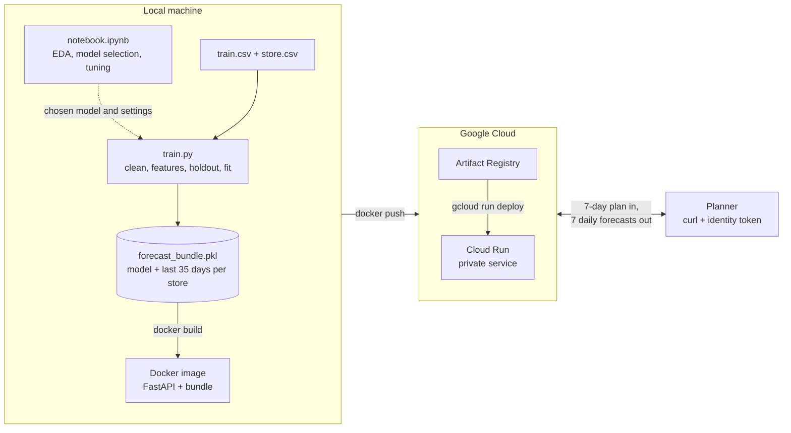
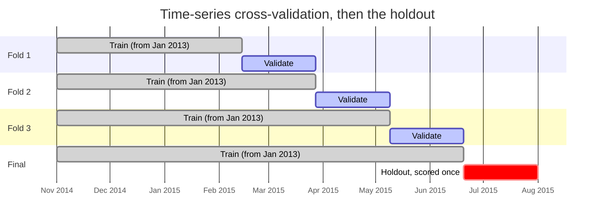
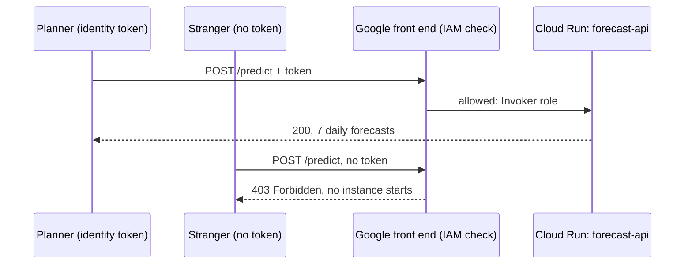
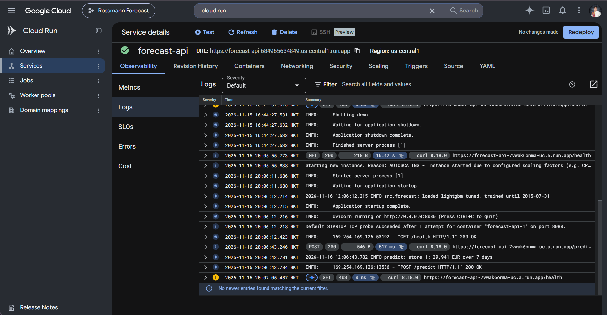
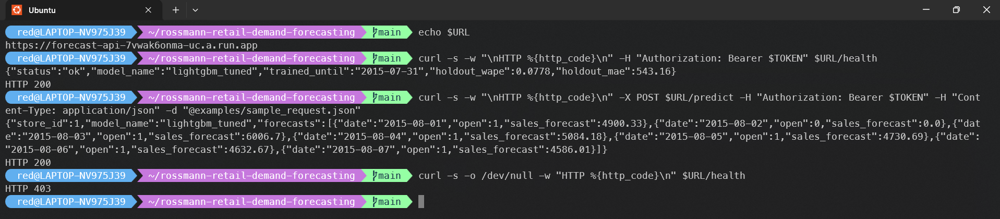

# Rossmann Retail Demand Forecasting


## Table of contents

1. [Executive summary](#executive-summary)
2. [Run it locally](#run-it-locally)
3. [Problem statement](#problem-statement)
4. [Dataset](#dataset)
5. [Approach](#approach)
6. [Results](#results)
7. [API reference](#api-reference)
8. [Deployment](#deployment)
9. [Limitations](#limitations)
10. [Next steps](#next-steps)

## Executive summary

Rossmann is one of Germany's largest drugstore chains, selling health and beauty products in stores across Europe. Every week, its store managers have to guess next week's sales to plan staff and stock, and a wrong guess means either empty shelves and lost sales, or overstock and wasted staff hours.

This project replaces that guess with a forecast built on each store's own history. A tuned LightGBM model, trained on more than 840,000 daily sales records from 1,115 stores, predicts every day of the coming week from the promotions and holidays already planned and the store's recent sales.

Tested on six weeks of data held back until the end, the model's forecasts were off by 7.8% of sales. The best simple baseline was off by 18%, so the error dropped by more than half.

| Model | WAPE (holdout) | MAE per store-day |
| --- | --- | --- |
| Same weekday last week | 31.4% | €2,190 |
| Store × weekday average | 18.0% | €1,254 |
| Tuned LightGBM | 7.8% | €543 |

The model is served through a FastAPI service, packaged with Docker, and deployed on Google Cloud Run. Store managers can now plan staff and stock with 57% less forecast error than the best rule of thumb, which means fewer empty shelves and less money tied up in overstock.

## Run it locally

You need Git and Docker. The commands work on Windows, macOS, and Linux unless a step shows separate versions.

### 0. Install uv (if you don't have it)

```bash
# macOS and Linux
curl -LsSf https://astral.sh/uv/install.sh | sh
```

```powershell
# Windows (PowerShell)
powershell -ExecutionPolicy ByPass -c "irm https://astral.sh/uv/install.ps1 | iex"
```

Installs [uv](https://docs.astral.sh/uv/), which manages the Python version and the project's dependencies; open a new terminal afterwards and check it with `uv --version`.

### 1. Clone the repo

```bash
git clone https://github.com/rimvelvet31/rossmann-retail-demand-forecasting.git
cd rossmann-retail-demand-forecasting
```

Gets the code and moves into the project folder.

### 2. Install the dependencies

```bash
uv sync --locked
```

Creates a virtual environment in `.venv` with Python 3.12 and the exact versions pinned in `uv.lock`, and stops with an error instead of changing them if the lock file is out of date.

On macOS, also run `brew install libomp` once: LightGBM needs it for steps 4 and 5 (the Docker image already has it).

To activate it (optional, since `uv run` uses it automatically):

```bash
# macOS and Linux
source .venv/bin/activate
```

```powershell
# Windows (PowerShell or Command Prompt)
.venv\Scripts\activate
```

### 3. Download the data

```bash
uv run python scripts/download_data.py
```

Fetches `train.csv` and `store.csv` into `data/raw/`, which git ignores. If the download fails, get both files from the [Kaggle competition page](https://www.kaggle.com/c/rossmann-store-sales/data) and put them in `data/raw/`.

### 4. Train the model

```bash
uv run python train.py
```

Cleans the data, builds the features, scores the holdout once, and saves the model bundle the API needs (about 1 minute).

### 5. Explore the notebook (optional)

```bash
uv run jupyter notebook notebooks/notebook.ipynb
```

Holds the full EDA, model comparison, and tuning; a full run takes about 30 minutes and several GB of memory.

### 6. Start the API

Pick one way: both serve the API at `http://localhost:8080`, with interactive docs at `/docs`, so run only one at a time.

#### With Docker (recommended)

```bash
docker build -t forecast-api:v1 .
docker run --rm -p 8080:8080 forecast-api:v1
```

Builds an image with the API and the model bundle from step 4 (run that step first), then starts the server in a container. It is the same image that runs on Cloud Run. On Apple Silicon Macs, add `--platform linux/amd64` to the build command if you'll push the image to Cloud Run (it runs amd64).

#### Without Docker

```bash
uv run uvicorn predict:app --port 8080
```

Loads the model once and starts the server from your virtual environment.

### 7. Call the API

In a second terminal:

```bash
# macOS and Linux
curl -X POST localhost:8080/predict -H "Content-Type: application/json" -d "@examples/sample_request.json"
```

```powershell
# Windows (PowerShell)
curl.exe -X POST localhost:8080/predict -H "Content-Type: application/json" -d "@examples/sample_request.json"
```

Sends store 1's plan for 2015-08-01 to 08-07 and returns 7 daily forecasts in euros, with the same result whether the server runs in Docker or not.

The request and response fields are in [API reference](#api-reference).

## Problem statement

Rossmann's store managers plan staff and stock a week at a time, so they need a sales number for each of the next 7 days, not one total for the week. This project treats that as a regression problem: for each store, predict daily sales in euros for each of the 7 days after the last day of data.

The model may only use what is known before the week starts: the store's past sales and the week's plan (open days, promotions, and holidays). Same-day figures such as the number of customers are left out, because they're only known once the day is over.

### How the forecast is used

A planner sends the store ID and the week's plan to the API and gets back 7 daily forecasts. The store's sales history stays on the server, so the planner never has to send it, and closed days return 0 because a closed store sells nothing.

### Success metric

The headline metric is **WAPE** (weighted absolute percentage error), which reads as "off by X% of sales". Unlike MAPE, it doesn't blow up on low-sales days, so a few quiet days can't distort the score.

```math
\text{WAPE} = \frac{\sum_{i=1}^{n} |y_i - \hat{y}_i|}{\sum_{i=1}^{n} y_i}
```

**MAE** (mean absolute error) reports the same error in euros per store-day.

```math
\text{MAE} = \frac{1}{n} \sum_{i=1}^{n} |y_i - \hat{y}_i|
```

Here $y_i$ is the actual sales and $\hat{y}_i$ the forecast for store-day $i$, over the $n$ open store-days being scored. To count as useful, the model has to beat two simple baselines a planner could use without ML: the same weekday last week, and the store's average for that weekday.

## Dataset

The data comes from the [Rossmann Store Sales](https://www.kaggle.com/c/rossmann-store-sales/data) competition on Kaggle, provided by Dirk Rossmann GmbH. It holds 1,017,209 daily records for 1,115 stores, from 2013-01-01 to 2015-07-31.

| File | Contents | Used for |
| --- | --- | --- |
| `train.csv` | One row per store per day: sales, customers, opening, promotions, and holidays | The target and the daily inputs |
| `store.csv` | One row per store: store type, assortment, nearest competitor, and a continuing promotion (Promo2) | Store-level features |

The target is `Sales`, in euros per store per day. Kaggle's `test.csv` has no `Sales` column, so it isn't used, and the final holdout comes from the last 6 weeks of `train.csv` instead.

Not every day is recorded: 33,121 store-days (3.2%) have no row, mostly because 180 stores are missing the same block from 2014-07-01 to 2014-12-31. Those days are treated as missing, not as zero sales.

To get the files, see [step 3](#3-download-the-data).

### Data dictionary

#### `train.csv`

| Column | Meaning |
| --- | --- |
| `Store` | Store ID, 1 to 1,115 |
| `Date` | Calendar day |
| `DayOfWeek` | 1 = Monday to 7 = Sunday |
| `Sales` | Turnover in euros that day (**target**) |
| `Customers` | Number of customers that day (not a model input: only known after the day ends) |
| `Open` | 0 = closed, 1 = open |
| `Promo` | Whether the store ran a promotion that day |
| `StateHoliday` | `0` none, `a` public, `b` Easter, `c` Christmas (recoded to `none`, `public`, `easter`, and `christmas` during cleaning) |
| `SchoolHoliday` | Whether the store was affected by school closures |

#### `store.csv`

| Column | Meaning |
| --- | --- |
| `Store` | Store ID, 1 to 1,115 (joins to `train.csv`) |
| `StoreType` | Store model, `a` to `d` |
| `Assortment` | Product range: `a` basic, `b` extra, `c` extended |
| `CompetitionDistance` | Distance in metres to the nearest competitor |
| `CompetitionOpenSinceMonth`, `CompetitionOpenSinceYear` | When the nearest competitor opened |
| `Promo2` | Whether the store takes part in a continuing promotion (0 or 1) |
| `Promo2SinceWeek`, `Promo2SinceYear` | When the store joined that promotion |
| `PromoInterval` | Months when a Promo2 round restarts, e.g. `Feb,May,Aug,Nov` |

## Approach

### Architecture



The notebook is where the model was chosen and tuned, and `train.py` turns that choice into a repeatable script. The saved bundle travels inside the Docker image to Cloud Run, where a planner sends a week's plan and gets forecasts back.

### Method

#### 1. Clean the data

The two raw files go through 12 fixes, and each one is logged with the issue, the fix, and the reason. The main ones:

- 54 open days with zero sales are dropped, since they are most likely unrecorded closures.
- Store 815's competitor opening date of January 1900 is set to missing, as a probable placeholder.
- 3 missing competitor distances are filled with the median (2,325 m).
- Year, month, and week columns are combined into two dates: `competition_open_since` and `promo2_since`.
- Holiday and assortment codes become words (`a` → `public`, `b` → `easter`, and so on).

Two things are left alone on purpose. The 172,817 closed days stay in the table, flagged by `open`, and the 33,121 missing store-days stay missing instead of being filled with zeros.

Sixteen automated checks then guard the result, such as one row per store and day, zero sales on every closed day, and no rows lost in the merge. The clean table has 1,017,155 rows and 16 columns.

#### 2. Build features

Each store-day gets 34 features in six groups:

| Group | Features | What they capture |
| --- | --- | --- |
| Store and day (6) | `store_id`, `day_of_week`, `promo`, `school_holiday`, `competition_distance`, `promo2` | The store, the weekday, the day's plan, and fixed store details |
| Sales history (6) | `sales_lag_7`, `sales_lag_14`, `sales_lag_21`, `sales_lag_28`, `sales_lag_mean`, `sales_mean_28d` | Sales 7, 14, 21, and 28 days back, their average, and the 28-day average ending 7 days back |
| Promotions on the lag days (4) | `promo_lag_7`, `promo_lag_14`, `promo_lag_21`, `promo_lag_28` | Whether each of those past days had a promotion |
| Calendar and holidays (4) | `month`, `day_of_month`, `days_to_holiday`, `days_since_holiday` | The date, and the days to and since the nearest national holiday (capped at 14) |
| Store status (3) | `competition_months_open`, `promo2_active`, `promo2_round_month` | Months since the nearest competitor opened (capped at 24), and whether Promo2 is running or restarting that month |
| Categories (11) | `store_type_a`, `store_type_b`, `store_type_c`, `store_type_d`, `assortment_basic`, `assortment_extended`, `assortment_extra`, `state_holiday_christmas`, `state_holiday_easter`, `state_holiday_none`, `state_holiday_public` | Store type, assortment, and state holiday, one-hot encoded |

Before any lag is built, sales on closed days are set to missing, so a closed Sunday never looks like a day with zero demand. A national holiday is any date flagged as a holiday in at least 90% of stores, which gives 24 dates.

The data ends on Friday 2015-07-31, so on forecast day 7 the newest known sales are exactly 7 days old. Only lags of 7 days or more are known for every day of the week, which is why one model with lags 7, 14, 21, and 28 can forecast all 7 days:

| Forecast day | 1 day back | 2 | 3 | 4 | 5 | 6 | 7 or more |
| --- | --- | --- | --- | --- | --- | --- | --- |
| Day 1 (Sat Aug 1) | ✓ | ✓ | ✓ | ✓ | ✓ | ✓ | ✓ |
| Day 2 (Sun Aug 2) | ✗ | ✓ | ✓ | ✓ | ✓ | ✓ | ✓ |
| Day 3 (Mon Aug 3) | ✗ | ✗ | ✓ | ✓ | ✓ | ✓ | ✓ |
| Day 4 (Tue Aug 4) | ✗ | ✗ | ✗ | ✓ | ✓ | ✓ | ✓ |
| Day 5 (Wed Aug 5) | ✗ | ✗ | ✗ | ✗ | ✓ | ✓ | ✓ |
| Day 6 (Thu Aug 6) | ✗ | ✗ | ✗ | ✗ | ✗ | ✓ | ✓ |
| Day 7 (Fri Aug 7) | ✗ | ✗ | ✗ | ✗ | ✗ | ✗ | ✓ |

✓ already known when the forecast is made, ✗ not yet.

Leakage is tested, not assumed. The test changes sales from a cutoff date onward and confirms that no feature moves in the 6 days after it, while features 7 days after it do change, which proves the test can catch a leak.

#### 3. Validate

A random split would let a model train on days after the ones it predicts, so the models are compared with time-series cross-validation instead. Each fold trains on every day before a 6-week window and predicts that window:



| Fold | Trains on | Predicts | Training rows |
| --- | --- | --- | --- |
| 1 | Days before 2015-02-14 | 2015-02-14 to 2015-03-27 | 689,365 |
| 2 | Days before 2015-03-28 | 2015-03-28 to 2015-05-08 | 729,540 |
| 3 | Days before 2015-05-09 | 2015-05-09 to 2015-06-19 | 766,584 |

The last 6 weeks (2015-06-20 to 2015-07-31, 40,282 open store-days) form the holdout, which stays untouched until the final model is chosen and is scored once. Store averages, such as the second baseline, come from each fold's training rows only, and 7 more checks confirm the folds sit back to back and never touch the holdout.

#### 4. Train and tune

Two baselines set the bar: the same weekday last week, and the store's average for that weekday. Three models then compete, each set up for how it learns:

- **Ridge** (linear): skips the store ID, one-hot encodes weekday and month, and fills missing lags from training rows only.
- **Random forest**: skips the store ID, keeps at least 5 rows per leaf, and samples half the features per split and half the rows per tree; left untuned because it trailed LightGBM and took about 13 times longer to train.
- **LightGBM** (gradient-boosted trees): takes the store ID as a category and handles missing lags natively.

Every model was also tried on a `log1p` sales target, which helped none of them. Ridge's penalty was tuned over a grid, and LightGBM with 30 Optuna trials on fold 3 using early stopping, after which the best 3 settings were rechecked on all 3 folds.

`train.py` then refits the tuned LightGBM on all 844,338 open store-days and saves one bundle: the model, the feature list, the category values, the national holidays, and the last 35 days of every store's sales.

#### 5. Serve

A forecast needs history: the 28-day average for the first forecast day reaches back 34 days, so the bundle keeps 35. The API appends the planner's 7 days to the store's history, copies the store details from its last row, and runs the same `build_features` function used in training (`src/features.py`).

Shared code removes most training-serving skew, and `scripts/check_parity.py` proves it for this project. It pretends the data ends on 2015-07-24, builds the next 7 days the API way for 4 stores (one of each type), and confirms all 34 features equal the training table. Run it with `uv run python -m scripts.check_parity` after step 3.

### Key decisions and trade-offs

| Decision | Choice | Why | Trade-off |
| --- | --- | --- | --- |
| Forecasting strategy | One model for all 7 days, with every sales lag at least 7 days back | Simple, and no error builds up from day to day | Day 1 can't use yesterday's sales |
| Lags | Built by calendar date, not row position | 33,121 missing days would shift row-based lags onto the wrong dates | A lag is empty when that past day is missing (LightGBM accepts that; Ridge fills it) |
| Closed days | Dropped from training; the API returns 0 | Sales are 0 by schedule, not by demand | Relies on the plan's `open` flag being right |
| `Customers` | Left out | Only known after the day ends, so using it would leak the answer | Gives up a strong signal |
| Validation | 3 expanding time-series folds, then a 6-week holdout scored once | Mimics forecasting the future, and the holdout stays unbiased | Every model is fitted 3 times |
| Metric | WAPE as headline, MAE alongside | Reads as "% of sales" and doesn't blow up on quiet days | Big stores weigh more than small ones |
| Target | Sales in euros, not `log1p` | `log1p` helped no model in the backtest | The skewed target stays as it is |
| Model | Tuned LightGBM | Won every fold (7.4% WAPE against 8.5% for the random forest and 11.4% for Ridge) and handles missing values natively | Harder to explain than Ridge |
| API input | Store ID plus the 7-day plan; the server keeps the history | The planner sends only what they know | Forecasts only the week after the data ends |
| Hosting | Private Cloud Run service, 1 instance at most, scales to zero | Stays within the free tier and can't be abused | Callers need a Google identity token; the first call after idle is slower while an instance starts (2 to 16 seconds measured) |

## Results

### EDA insights

| Finding | What the model does with it |
| --- | --- |
| Promotions lift Monday-to-Friday sales by 38.7% on average | Uses the planned `promo` flag, plus the promo flag of each lag day |
| The weekly cycle explains 66% of the variation in daily total sales | Uses the weekday and sales from 7, 14, 21, and 28 days back |
| Sales 14 and 28 days back match today best (autocorrelation 0.72 and 0.69), because promotion weeks alternate | Keeps every lag a multiple of 7 days |
| 26 of the 30 days furthest below the weekly pattern are public holidays, and the days just before them spike | Counts the days to and since the nearest holiday |
| The 17 type-b stores sell about €10,200 per open day, against about €6,900 for the other types | Keeps store type as a category |
| 180 stores have no data for the second half of 2014 | Builds lags by calendar date and leaves missing lags empty |

### Model comparison

Each model was scored with time-series cross-validation over 3 back-to-back 6-week folds.

| Model | WAPE (mean of 3 folds) | MAE per store-day |
| --- | --- | --- |
| Same weekday last week | 28.0% | €2,026 |
| Store × weekday average | 17.1% | €1,242 |
| Ridge | 11.4% | €833 |
| Random forest | 8.5% | €613 |
| LightGBM (default settings) | 8.2% | €597 |
| **LightGBM (tuned)** | **7.4%** | **€539** |

Tuned LightGBM won every fold (7.0%, 8.0%, and 7.4%). On the untouched 6-week holdout it scored 7.8%, inside the range of its three folds, so the tuning did not overfit them.

### Tuning

Ridge barely reacted to its penalty: any alpha from 0.1 to 100 gave 11.4%, so the default of 1.0 stayed. For LightGBM, the best 3 Optuna settings all scored 7.4% to 7.5%, and the one needing the fewest trees was kept.

| LightGBM setting | Default | Tuned |
| --- | --- | --- |
| `num_leaves` | 31 | 233 |
| `min_child_samples` | 20 | 51 |
| `colsample_bytree` | 1.0 | 0.785 |
| Trees (`n_estimators`) | 100 | 357 |
| **WAPE (mean of 3 folds)** | **8.2%** | **7.4%** |

### Holdout by store type

| Store type | Stores | WAPE |
| --- | --- | --- |
| a | 602 | 7.9% |
| b | 17 | 6.1% |
| c | 148 | 7.9% |
| d | 348 | 7.7% |

The error stays within 2 points across store types, so no group of stores is left behind.

### Feature importance

Permutation importance shows how much the error rises when one feature's values are shuffled, which breaks its link to sales.

| Feature | Meaning | WAPE rise when shuffled |
| --- | --- | --- |
| `promo` | Promotion planned that day | +9.3 points |
| `sales_lag_mean` | Average sales 7, 14, 21, and 28 days back | +7.5 points |
| `store_id` | Which store | +6.8 points |
| `sales_mean_28d` | Average daily sales over the 28 days ending a week before | +3.1 points |
| `day_of_week` | Monday to Sunday | +2.6 points |

The forecast rests on three things: what is planned, the store's recent level, and the store itself. 19 of the 34 features add 0.14 points or less each.

## API reference

| Endpoint | Returns |
| --- | --- |
| `GET /health` | Status, model name, the last date of the data, and the holdout scores |
| `POST /predict` | 7 daily sales forecasts in euros for one store |

The same schemas are on the interactive docs page at `/docs` while the server runs.

### Request schema

| Field | Type | Allowed values |
| --- | --- | --- |
| `store_id` | integer | 1 to 1,115 |
| `days` | list | Exactly 7 items, one per date from 2015-08-01 to 2015-08-07, in any order |
| `days[].date` | date (`YYYY-MM-DD`) | 2015-08-01 to 2015-08-07 |
| `days[].open` | integer | 0 or 1 |
| `days[].promo` | integer | 0 or 1 |
| `days[].state_holiday` | string | `none`, `public`, `easter`, or `christmas` |
| `days[].school_holiday` | integer | 0 or 1 |

### Request example

The plan for store 1's week after the data ends, saved as `examples/sample_request.json`:

```json
{
  "store_id": 1,
  "days": [
    {"date": "2015-08-01", "open": 1, "promo": 0, "state_holiday": "none", "school_holiday": 1},
    {"date": "2015-08-02", "open": 0, "promo": 0, "state_holiday": "none", "school_holiday": 1},
    {"date": "2015-08-03", "open": 1, "promo": 1, "state_holiday": "none", "school_holiday": 1},
    {"date": "2015-08-04", "open": 1, "promo": 1, "state_holiday": "none", "school_holiday": 1},
    {"date": "2015-08-05", "open": 1, "promo": 1, "state_holiday": "none", "school_holiday": 1},
    {"date": "2015-08-06", "open": 1, "promo": 1, "state_holiday": "none", "school_holiday": 1},
    {"date": "2015-08-07", "open": 1, "promo": 1, "state_holiday": "none", "school_holiday": 1}
  ]
}
```

### Response schema

| Field | Type | Meaning |
| --- | --- | --- |
| `store_id` | integer | The store from the request |
| `model_name` | string | The model that made the forecasts |
| `forecasts` | list | 7 items, one per day, in date order |
| `forecasts[].date` | date | The day |
| `forecasts[].open` | integer | 0 or 1, copied from the request |
| `forecasts[].sales_forecast` | number | Forecast sales in euros, 0 on closed days |

### Response example

```json
{
  "store_id": 1,
  "model_name": "lightgbm_tuned",
  "forecasts": [
    {"date": "2015-08-01", "open": 1, "sales_forecast": 4900.33},
    {"date": "2015-08-02", "open": 0, "sales_forecast": 0.0},
    {"date": "2015-08-03", "open": 1, "sales_forecast": 6006.7},
    {"date": "2015-08-04", "open": 1, "sales_forecast": 5084.18},
    {"date": "2015-08-05", "open": 1, "sales_forecast": 4730.69},
    {"date": "2015-08-06", "open": 1, "sales_forecast": 4632.67},
    {"date": "2015-08-07", "open": 1, "sales_forecast": 4586.01}
  ]
}
```

If you retrain on another machine, the last digits can differ slightly.

### Status codes

| Status | When |
| --- | --- |
| 200 | Forecasts returned |
| 404 | Unknown `store_id` |
| 422 | Invalid input: a wrong value, not exactly 7 days, or dates outside 2015-08-01 to 08-07 |
| 500 | Unexpected server error (logged with the full traceback) |

## Deployment

The API runs on Google Cloud Run, which starts a container only when a request arrives and scales back to zero when idle. The image is built locally, pushed to Artifact Registry, and deployed with one command.

The service is private, the way companies run internal ML services. A forecast API normally sits behind the company's own apps, such as a planning tool or a nightly job, so each caller gets its own Google identity with only the Cloud Run Invoker role (least privilege), and every request must carry a signed identity token.

No request is trusted because of where it comes from: Google's front end checks the token and answers 403 before an instance even starts, so the model can't be scraped or abused, and an idle service costs nothing. Reviewers can run the same API locally (see [Run it locally](#run-it-locally)), and the screenshots below show the cloud service answering.

### How a request reaches the model



### Live service

URL: `https://forecast-api-684965634849.us-central1.run.app` (returns 403 without a token, by design). Cloud Run also serves it at the older-style address `https://forecast-api-7vwak6onma-uc.a.run.app`, which appears in the screenshots.



The request logs show the instance starting and loading the model, the two 200 responses, and the call without a token rejected with 403 in 0 ms, before it reaches the container.



### Locked-down settings

| Setting | Value | Why |
| --- | --- | --- |
| Access | `--no-allow-unauthenticated` | Only the Invoker role can call it |
| Instances | 0 to 1 | Scales to zero when idle and caps the worst case |
| Billing | Request-based (the default) | Billed only while a request is handled |
| Memory | 1 GiB | Room for pandas and LightGBM |
| Cost guard | $1 spend cap on Cloud Run, plus a $1 alert budget | A backstop if anything goes wrong |

### How it was deployed

These are the commands that deployed the service, run in bash on WSL. Repeating them needs a Google Cloud project with billing, the [gcloud CLI](https://cloud.google.com/sdk/docs/install), and the image from step 6 of Run it locally (bash on macOS or Linux works too, and Git Bash on Windows).

#### 1. Set up the project

```bash
gcloud auth login
gcloud config set project YOUR_PROJECT_ID
gcloud services enable run.googleapis.com artifactregistry.googleapis.com
```

Logs in, picks your project, and turns on the two services the deploy needs.

#### 2. Set the variables

```bash
PROJECT_ID=$(gcloud config get-value project)
REGION=us-central1
REPO=rossmann
IMAGE=$REGION-docker.pkg.dev/$PROJECT_ID/$REPO/forecast-api:v1
```

Saves the names the next commands reuse; set them again in every new terminal.

#### 3. Push the image

```bash
gcloud artifacts repositories create $REPO --repository-format=docker --location=$REGION --disable-vulnerability-scanning
gcloud auth configure-docker $REGION-docker.pkg.dev
docker tag forecast-api:v1 $IMAGE
docker push $IMAGE
```

Creates a private image repository, lets Docker log in to it, and uploads the image under its full registry name.

#### 4. Deploy

```bash
gcloud run deploy forecast-api --image=$IMAGE --region=$REGION --no-allow-unauthenticated --max-instances=1 --memory=1Gi --port=8080
```

Creates the private service and prints its URL.

#### 5. Test it

```bash
URL=$(gcloud run services describe forecast-api --region=$REGION --format='value(status.url)')
TOKEN=$(gcloud auth print-identity-token)
curl -H "Authorization: Bearer $TOKEN" $URL/health
curl -X POST $URL/predict -H "Authorization: Bearer $TOKEN" -H "Content-Type: application/json" -d "@examples/sample_request.json"
curl $URL/health
```

Calls the service with your identity token (both answer 200), then without one (403).

### Tear down

```bash
gcloud projects delete $PROJECT_ID
```

Deletes the project and everything in it, so nothing is left to bill.

## Limitations

The data is a fixed Kaggle snapshot that ends on 2015-07-31, not a live feed that updates daily. Most of the limits below come from that, not from the model.

- **One forecast week.** Each forecast needs the store's last 35 days of real sales, so the API covers only 2015-08-01 to 2015-08-07. In production, a daily job would append new sales to the history and the model would be retrained on a schedule.
- **Frozen calendar and store details.** Holidays are learned from the data, and competitor and Promo2 details come from each store's last recorded day. That holds for the forecast week, but later weeks would need a holiday calendar and an updated store table.

## Next steps

- **Prediction ranges.** Add a 90% range around each day's forecast, built from past backtest errors per weekday, so planners can see how sure each number is.
- **Fresher first days.** Train a separate day-1 model that also uses yesterday's sales, and compare it with the current model on the first days of the week.
- **Planner app.** A Streamlit page where a planner picks a store, edits or uploads the week's plan, and gets a forecast table, a chart against the last 4 weeks of sales, and a CSV download. It would run as a second Cloud Run service with its own service account allowed to call the API.
- **Tests and CI/CD.** Turn the parity check and the API error cases into pytest tests, and let GitHub Actions run them, build the image, and deploy on every push.
- **Infrastructure as code.** Describe the project, the registry, and the Cloud Run service in Terraform, so the whole setup is created or deleted with one command.
- **Retraining and monitoring.** Schedule a daily history refresh and regular retraining with Airflow or Prefect, track runs in MLflow, and watch for drift with Evidently.
